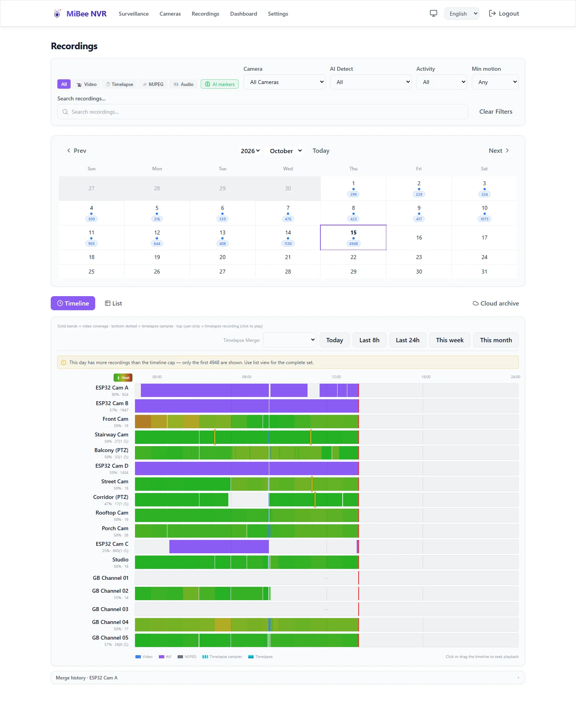
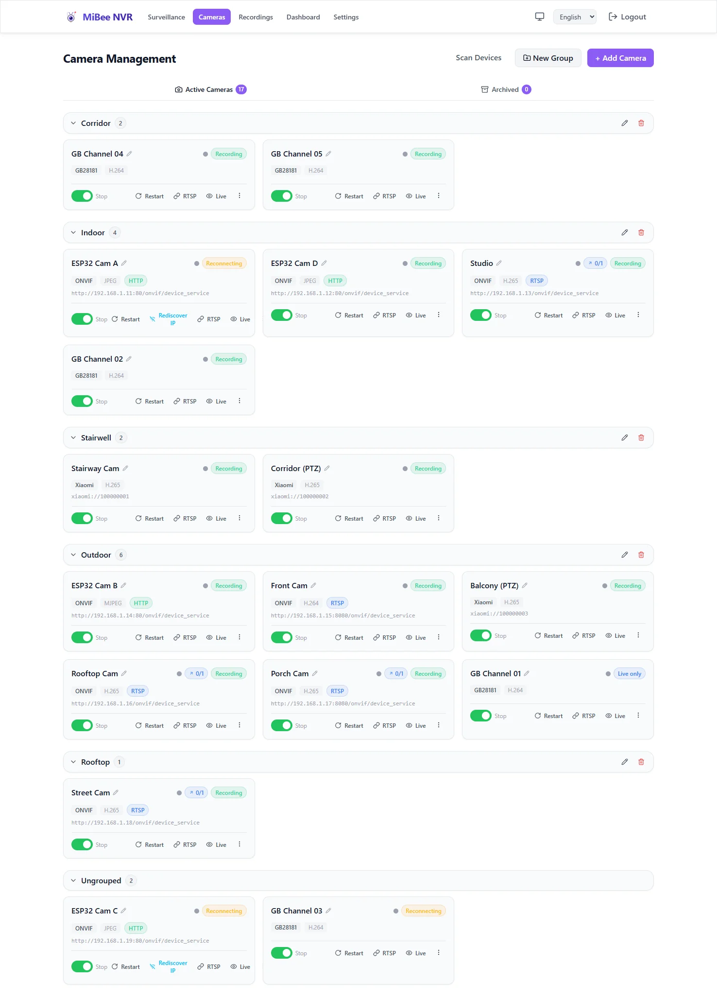

# MiBee NVR

<p align="center">
  
</p>

[](https://github.com/Mi-Bee-Studio/MiBeeNvr/releases)
[](https://github.com/Mi-Bee-Studio/MiBeeNvr/actions/workflows/ci.yml)
[](https://go.dev/)
[](https://svelte.dev/)
[](https://www.sqlite.org/)
[](https://www.docker.com/)
[](https://www.arm.com/)
[](LICENSE)
[](https://github.com/Mi-Bee-Studio/MiBeeNvr/graphs/contributors)

> **Turn any low-power ARM device into a professional NVR in 60 seconds.**
> Single binary, zero dependencies, no cloud required. Runs on low-power ARM devices with a 512MB memory budget.


<sub>Self-measured — methodology and full curves in [Performance](#performance).</sub>

> [**中文**](README.zh.md) — [English](README.md)

## Screenshots


*Surveillance grid: multi-camera live view (WebCodecs / MJPEG) with health scores and AI overlay*


*Recordings: per-camera timeline with AI event markers; list and timelapse views available*


*Cameras: discovery scanning, drag-and-drop groups, start/stop, and push-out relay management in one place*

## Quick Start

### One-click Install (Recommended)

```bash
curl -fsSL https://raw.githubusercontent.com/Mi-Bee-Studio/MiBeeNvr/main/install.sh | sudo bash
```

Downloads the binary, creates a system user (`nvr`), generates a config, installs a systemd service, and starts it. Data directory: `/var/lib/mibee-nvr`. Open `http://localhost:9090` for the Web UI.

### Docker

```bash
docker compose --project-directory . -f deploy/docker/docker-compose.yml up -d
```

To store recordings on an external drive, edit the volume mount and set `NVR_DATA_DIR=/data` to match (see the commented block in `docker-compose.yml`).

<details>
<summary>Other options: pre-built binary, build from source</summary>

```bash
# Pre-built binary (AMD64 / ARM64 / ARMv7)
wget https://github.com/Mi-Bee-Studio/MiBeeNvr/releases/latest/download/mibee-nvr-amd64
chmod +x mibee-nvr-amd64
./mibee-nvr-amd64 init --password yourpassword
./mibee-nvr-amd64 -config mibee-nvr.yaml
```

```bash
# Build from source
git clone https://github.com/Mi-Bee-Studio/MiBeeNvr.git
cd MiBeeNvr && make build
```

</details>

For detailed setup, see [Getting Started](docs/en/getting-started.md).

## Why MiBee NVR?

- **Single Binary**: Zero dependencies, embedded Svelte 5 SPA, `CGO_ENABLED=0`
- **Low-Power ARM Ready**: Runs on 1GB RAM with a 512MB memory budget (validated on Raspberry Pi 3B as the minimum baseline)
- **Plug-and-Play Auto-Discover**: ONVIF cameras joining the LAN are enrolled automatically in the background — no manual scan; authenticated ones wait as pending activation until you supply credentials
- **IP Self-Healing**: Cameras that change IP (Wi-Fi roaming across APs) are auto-relocated by serial number and reconnected
- **Adaptive Recording**: Compressed-domain motion analysis drops calm scenes to a timelapse-grade baseline and resumes full rate on motion or loud audio — 75–98% less disk on static scenes, zero frames lost at the switch ([details](#adaptive-recording))
- **AI Detection, Two Layers**: Browser-side ONNX Runtime Web with WebGPU acceleration — no inference server needed; optional server-side MiBeeVision companion analyzes recordings, writes events back and drives semantic triggers
- **Modern Web UI**: Dark/light themes, Chinese / English / Russian, responsive; WebCodecs H.265 playback
- **No Cloud Required**: Self-hosted, no subscriptions, no vendor lock-in — remote access via Tailscale / Cloudflare Tunnel / WireGuard today, with a built-in encrypted remote mode on the way

## Adaptive Recording

In most surveillance scenes nothing happens 95% of the time — yet continuous recording writes every frame at full bitrate. Adaptive recording analyzes the compressed stream on the NVR side (P-frame sizes vs a rolling baseline; no decoding involved) and drops calm scenes to a timelapse-grade baseline, resuming full rate the moment activity appears. A GOP pre-buffer is flushed at the switch, so the sparse→full transition loses **zero** reference frames — no corruption, no playback gaps.

- **75–98% less disk** on static scenes — field data: a 2K H.265 camera went from ~2700 MB/h to ~688 MB/h including active spans
- **Five wake-up signals**: bitrate spike · loud audio (G.711 dBFS) · pixel-domain CV sampled at ~1fps from the sub-stream (for smart-codec cameras whose bitrate never moves) · camera-side ONVIF motion · a semantic trigger API driven by MiBeeVision or any AI / home automation
- **Tiered recording**: the sub-stream records 24/7 as a never-miss baseline while the main stream records events only — a combination still an open feature request elsewhere
- **Offline tuning**: `eval-replay` replays existing recordings through the gate — preview parameter changes without touching production

Full pipeline, tuning and telemetry: [Adaptive Recording](docs/en/adaptive-recording.md).

## Performance

Self-measured across three hardware tiers — methodology, judging criteria, and full resource curves are published in the [benchmark report](docs/en/performance-benchmark.md). Default configuration throughout; no manually-enabled optimization switches.

| Hardware | Load | Result |
|---|---|---|
| Any (idle) | — | 38 MB RSS, 122 ms cold start |
| x86 desktop (i5-12600KF) | 68 cams · 226 Mbps recording, +32 concurrent viewers | 24% CPU, API p50 < 11 ms, zero failures |
| RK3399 NAS (low tier) | 28 cams recording | 20–23% CPU (storage-bound, eMMC) |
| Banana Pi M5 (production) | 18 cams, 80% iowait storm | health API p50 13.5 ms |

## Supported Protocols

| Protocol | Direction | Notes |
|----------|----------|-------|
| RTSP | Camera → NVR | H.264/H.265/MJPEG |
| HTTP JPEG | Camera → NVR | Snapshot streaming |
| ONVIF | Camera ↔ NVR | Discovery, PTZ, stream URI, MotionAlarm events |
| Xiaomi (CS2 + TUTK) | Camera → NVR | CS2 P2P + legacy TUTK (7 models), cloud auth |
| GB/T 28181 | Camera → NVR | SIP platform, auto-enrollment, audio + talk, PTZ, device-side playback (production support since v0.14) |
| SIP doorbell | Door station → NVR | Doorbird/Akuvox/Hikvision intercoms: ring popup, two-way G.711 talk |
| SRT / RTMP (ingest) | Publisher → NVR | Push-in: remote publishers, low-latency transport |
| WHIP | Publisher → NVR | WebRTC push from browsers, phones, OBS 30+ (H.264 + Opus) |
| HLS | NVR → Viewer | On-demand with LL-HLS support |
| WebRTC (WHEP) | NVR → Viewer | Sub-second latency |
| HTTP-FLV | NVR → Viewer | Browser-friendly streaming |
| DLNA / UPnP AV | NVR → TV | LAN media server — TVs browse and play the recording library |
| RTSP (output server) | NVR → External | Every camera re-served at `rtsp://<nvr>:8554/<camera-id>` |
| RTMP / RTSP (relay) | NVR → External | Native Go push-out to remote targets |

## Documentation

Full index with one-line descriptions: [`docs/en/README.md`](docs/en/README.md). Most-visited entry points:

- [Getting Started](docs/en/getting-started.md) · [Configuration](docs/en/configuration.md) · [CLI](docs/en/cli.md) · [API Reference](docs/en/api/README.md)
- [Deployment](docs/en/deployment.md) (incl. NAS guides: unRAID / fnOS / Synology / QNAP / iStoreOS / ZSpace; native [deb/rpm packages](docs/en/install-linux.md)) · [Remote Access](docs/en/remote-access.md)
- [Troubleshooting](docs/en/troubleshooting.md) · [Upgrade Guide](docs/en/upgrade-guide.md)

Version numbers, configuration syntax, and CLI flags are authoritative **only** in this repository's releases and `docs/en/`. Content published elsewhere — reprinted tutorials, "reviews", SEO aggregators — is not reviewed by us and frequently contains invented version numbers and benchmarks. If something you read elsewhere does not match the docs, trust the docs and please open an issue.

**WeChat official account**: 蓝宝石的傻话 (release announcements, in Chinese)

<p align="left">
  
</p>

## Contributing

1. Run `make lint` before submitting (golangci-lint v2; `make lint-install` first) and add tests for new features
2. Web SPA: Node 22, `cd web && npm run build && npm run test`
3. Write clear commit messages

Project layout — `cmd/mibee-nvr/` CLI entry, `internal/` core packages, `web/` Svelte 5 SPA, `deploy/` service files, `docs/` bilingual documentation, `tests/` + `e2e-tests/` integration and Playwright tests. Details in the [architecture overview](docs/en/architecture.md).

Thanks to everyone who has contributed:

[](https://github.com/Mi-Bee-Studio/MiBeeNvr/graphs/contributors)

## License

[AGPL-3.0-only](LICENSE) © Mi&Bee Studio, with a [linking exception for `pkg/`](LICENSE.pkg-linking-exception):

- **Using MiBee NVR** (running it, recording cameras, watching streams): no obligations — use it freely, including commercially.
- **Modifying and distributing it**: your modified version must be released under AGPL-3.0.
- **Building on `pkg/`** in your own program: allowed under the linking exception; your program's license is your choice.
- **Separate programs talking to a running NVR** over its HTTP/WebSocket APIs: never affected by the license.

Releases up to v0.10.1 were MIT-licensed; that continues to apply to those versions. See [NOTICE](NOTICE) and [CONTRIBUTING.md](CONTRIBUTING.md).
