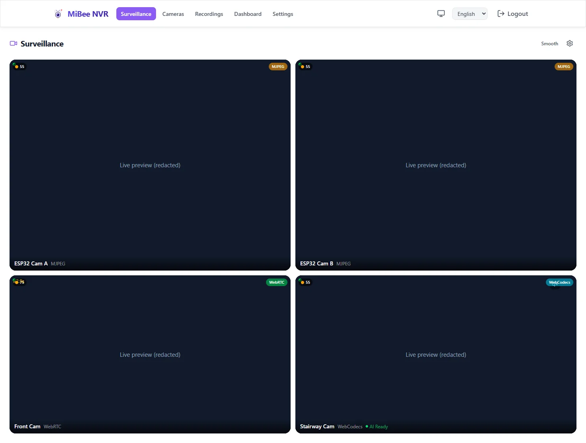

# MiBee NVR

<p align="center">
  
</p>

[](https://github.com/Mi-Bee-Studio/MiBeeNvr/releases)
[](https://github.com/Mi-Bee-Studio/MiBeeNvr/actions/workflows/ci.yml)
[](https://go.dev/)
[](https://svelte.dev/)
[](https://www.sqlite.org/)
[](https://www.docker.com/)
[](https://www.arm.com/)
[](LICENSE)
[](https://github.com/Mi-Bee-Studio/MiBeeNvr/graphs/contributors)

> **60 秒把任意低功耗 ARM 设备变成专业 NVR。**
> 单二进制、零依赖、无需云端。512MB 内存预算即可在低功耗 ARM 设备上运行。


<sub>自测值——测试方法与完整曲线见[性能](#性能)。</sub>

> [**中文**](README.zh.md) — [English](README.md)

## 截图


*监控宫格：多相机实时画面（WebCodecs / MJPEG），带健康评分与 AI 叠加*


*录像：按相机的时间轴与 AI 事件标记；支持列表与延时视图*


*摄像头：发现扫描、拖拽分组、启停管理、转推输出一站式完成*

## 快速开始

### 一键安装（推荐）

```bash
curl -fsSL https://raw.githubusercontent.com/Mi-Bee-Studio/MiBeeNvr/main/install.sh | sudo bash
```

自动下载二进制、创建系统用户（`nvr`）、生成配置、安装 systemd 服务并启动。数据目录 `/var/lib/mibee-nvr`，浏览器打开 `http://localhost:9090` 进入 Web 界面。

### Docker

```bash
docker compose --project-directory . -f deploy/docker/docker-compose.yml up -d
```

录像存外接盘时，修改 `docker-compose.yml` 中的卷挂载并设置 `NVR_DATA_DIR=/data` 与之对应（文件内有注释示例）。

<details>
<summary>其它方式：预编译二进制、源码编译</summary>

```bash
# 预编译二进制（AMD64 / ARM64 / ARMv7）
wget https://github.com/Mi-Bee-Studio/MiBeeNvr/releases/latest/download/mibee-nvr-arm64
chmod +x mibee-nvr-arm64
./mibee-nvr-arm64 init --password 你的密码
./mibee-nvr-arm64 -config mibee-nvr.yaml
```

```bash
# 源码编译
git clone https://github.com/Mi-Bee-Studio/MiBeeNvr.git
cd MiBeeNvr && make build
```

</details>

详细步骤见[快速上手](docs/zh/getting-started.md)。

## 为什么选 MiBee NVR？

- **单二进制**：零依赖、内嵌 Svelte 5 SPA、`CGO_ENABLED=0`
- **低功耗 ARM 就绪**：1GB 内存可跑，512MB 内存预算（以树莓派 3B 为最低基线验证）
- **即插即录自动发现**：ONVIF 相机入网即后台自动注册，无需手动扫描；带凭据的相机以待激活状态等待你补齐凭据
- **IP 自愈**：Wi-Fi 漫游跨 AP 换 IP 的相机按序列号自动寻回并重连
- **自适应录制**：压缩域运动分析让安静画面降为延时级稀疏写入，动静或响亮声音即刻恢复全速——静态场景省盘 75%–98%，切换零丢帧（[详见下文](#自适应录制)）
- **双层 AI 检测**：浏览器端 ONNX Runtime Web + WebGPU 加速、无需推理服务器；服务端可选官方伴随引擎 MiBeeVision——分析录像、事件回写、语义触发自适应录制
- **现代 Web 界面**：深浅主题、中/英/俄三语、响应式；WebCodecs 播放 H.265
- **无需云端**：自托管、无订阅、无锁定——当下用 Tailscale / Cloudflare Tunnel / WireGuard 远程访问，内置加密远程模式在路上

## 自适应录制

监控画面 95% 的时间无事发生，连续录像却始终全帧率写盘。自适应录制在 NVR 侧分析压缩码流（P 帧尺寸相对滚动基线的偏离，全程零解码），安静时降为延时级稀疏写入，一有动静立即恢复全帧率。切换瞬间冲刷 GOP 预缓冲，稀疏→全速**零丢帧**——不花屏、回放无空洞。

- **静态场景省盘 75%–98%**——实测数据：2K H.265 相机从 ~2700 MB/h 降到 ~688 MB/h（含活动时段）
- **五路唤醒信号**：码率尖峰 · 异常响声（G.711 dBFS）· 子码流 ~1fps 采样像素域 CV（专治码率恒定的智能编码器相机）· 相机侧 ONVIF 移动侦测 · 语义触发 API（MiBeeVision 官方引擎或任意 AI / 家庭自动化）
- **分层录制**：子码流 24/7 连续兜底、一帧不漏，主码流只录事件——这个组合在其他 NVR 里仍是开放的特性请求
- **离线调参**：`eval-replay` 用既有录像回放门控决策，不碰生产就能预演参数效果

完整管线、调参与遥测详见[自适应录制](docs/zh/adaptive-recording.md)。

## 性能

三个硬件档位的自测数据——测试方法、判定口径与完整资源曲线见[压测报告](docs/zh/performance-benchmark.md)。全程出厂默认配置，不含任何需手动打开的优化开关。

| 硬件 | 负载 | 结果 |
|---|---|---|
| 任意（空载） | — | 内存 38 MB，冷启动 122 ms |
| x86 台式机（i5-12600KF） | 68 路 · 226 Mbps 录制，另加 32 路并发观看 | CPU 24%，API p50 < 11 ms，零失败 |
| RK3399 NAS（低配档） | 28 路录制 | CPU 20–23%（瓶颈在 eMMC 存储） |
| Banana Pi M5（生产机） | 18 路，80% iowait 风暴 | health API p50 13.5 ms |

## 支持的协议

| 协议 | 方向 | 说明 |
|------|------|------|
| RTSP | 相机 → NVR | H.264/H.265/MJPEG |
| HTTP JPEG | 相机 → NVR | 快照流 |
| ONVIF | 相机 ↔ NVR | 发现、云台、流地址、MotionAlarm 事件 |
| 小米（CS2 + TUTK） | 相机 → NVR | CS2 P2P + 旧版 TUTK（7 型号），云端认证 |
| GB/T 28181 | 相机 → NVR | SIP 平台、自动注册、语音对讲、云台、设备侧回放 |
| SIP 门铃 | 门禁设备 → NVR | Doorbird/Akuvox/海康门口机：来电弹窗、双向 G.711 对讲 |
| SRT / RTMP（接入） | 推流端 → NVR | 跨网络推入、低延迟传输 |
| WHIP | 推流端 → NVR | 浏览器 / 手机 / OBS 30+ 的 WebRTC 推流（H.264 + Opus） |
| HLS | NVR → 观看端 | 按需起流，支持 LL-HLS |
| WebRTC（WHEP） | NVR → 观看端 | 亚秒延迟 |
| HTTP-FLV | NVR → 观看端 | 浏览器友好 |
| DLNA / UPnP AV | NVR → 电视 | 局域网媒体服务器——电视直接浏览播放录像库 |
| RTSP（输出服务） | NVR → 外部 | 每台相机一个地址 `rtsp://<nvr>:8554/<camera-id>` |
| RTMP / RTSP（转推） | NVR → 外部 | 原生 Go 转推至远端目标 |

## 文档

带一句话简介的完整目录见 [`docs/zh/README.md`](docs/zh/README.md)。常用入口：

- [快速上手](docs/zh/getting-started.md) · [配置参考](docs/zh/configuration.md) · [CLI](docs/zh/cli.md) · [API 参考](docs/zh/api/README.md)
- [部署](docs/zh/deployment.md)（含 NAS 指南：unRAID / fnOS / 群晖 / 威联通 / iStoreOS / 极空间；[deb/rpm 原生包](docs/zh/install-linux.md)）· [远程访问](docs/zh/remote-access.md)
- [故障排查](docs/zh/troubleshooting.md) · [升级指南](docs/zh/upgrade-guide.md)

版本号、配置语法、CLI 参数**只**以本仓库的 releases 与 `docs/zh/` 为权威来源。外部转载教程、“评测”、SEO 聚合页均未经我们审阅，常含有编造的版本号与跑分。若你看到的第三方内容与文档不符，以文档为准，欢迎提 issue 告知。

**微信公众号**：蓝宝石的傻话（版本发布公告，中文）

<p align="left">
  
</p>

## 贡献

1. 提交前跑 `make lint`（golangci-lint v2，先 `make lint-install`），新功能补测试
2. Web SPA：Node 22，`cd web && npm run build && npm run test`
3. 写清晰的提交信息

项目结构——`cmd/mibee-nvr/` CLI 入口、`internal/` 核心包、`web/` Svelte 5 SPA、`deploy/` 服务文件、`docs/` 中英双语文档、`tests/` + `e2e-tests/` 集成与 Playwright 测试。详见[架构总览](docs/zh/architecture.md)。

感谢所有贡献者：

[](https://github.com/Mi-Bee-Studio/MiBeeNvr/graphs/contributors)

## 许可证

[AGPL-3.0-only](LICENSE) © Mi&Bee Studio，附 [`pkg/` 链接例外](LICENSE.pkg-linking-exception)：

- **使用 MiBee NVR**（运行、录像、看流）：无任何义务——自由使用，包括商用。
- **修改并分发**：修改版须以 AGPL-3.0 发布。
- **基于 `pkg/` 构建自己的程序**：链接例外允许，你的程序许可自选。
- **通过 HTTP/WebSocket API 与运行中的 NVR 交互的独立程序**：从不受该许可证影响。

v0.10.1 及更早版本为 MIT 许可，对该范围继续有效。见 [NOTICE](NOTICE) 与 [CONTRIBUTING.md](CONTRIBUTING.md)。
