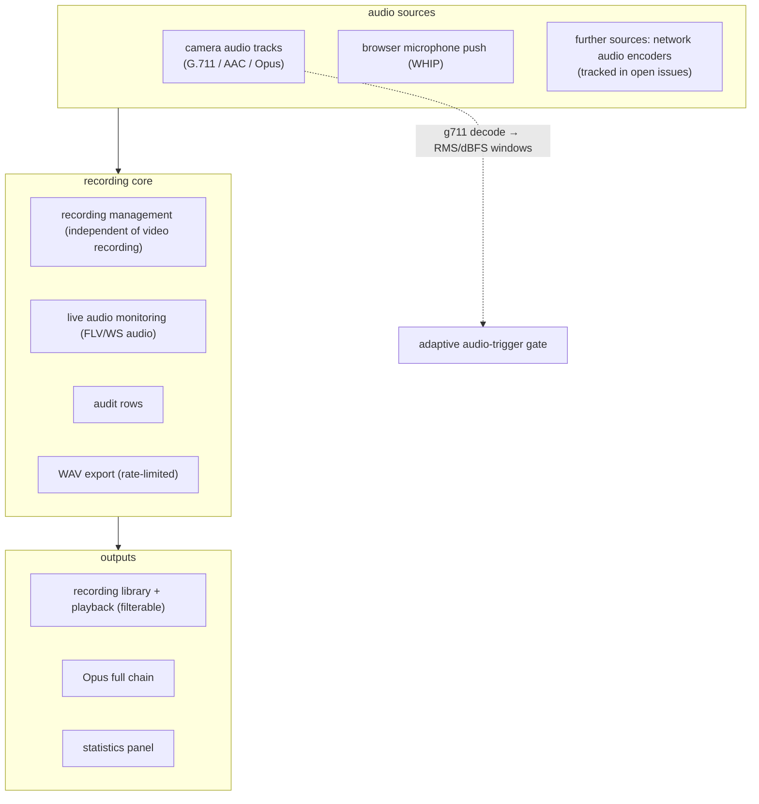

# Audio Recording Line

Beyond "audio tracks inside video recordings": a full independent audio
capability line, from camera audio to standalone recording devices.

## 1. Capability map

## 2. Design points

- **Decoupled from video recording**: `audio_in_recordings` is per-camera and
  defaults to false — recordings are video-only by default, while live
  monitoring and audio-triggered adaptive recording keep working. Recordings
  are an independent resource with their own listing, cleanup and statistics.
- **Format strategy**: live/monitor paths pass camera encodings through; storage
  transcodes per capability (full Opus chain); WAV exports are rate-limited.
- **Cascade filtering**: audio is stripped from cascade downlink channels at
  the cascade source.
- **Trigger decode**: G.711 µ/A-law is decoded with pure-Go lookup tables for
  the adaptive gate; AAC/Opus are skipped with a warning (no pure-Go decoder).

## 3. Open items (public tracker)

- Network audio encoders over the GB28181 form factor (needs protocol library
  extensions + real hardware).
- Audio tracks merged into the playback timeline (v2).
- The broader audio-source ecosystem (browser-pushed microphones are supported;
  others tracked in open issues).
