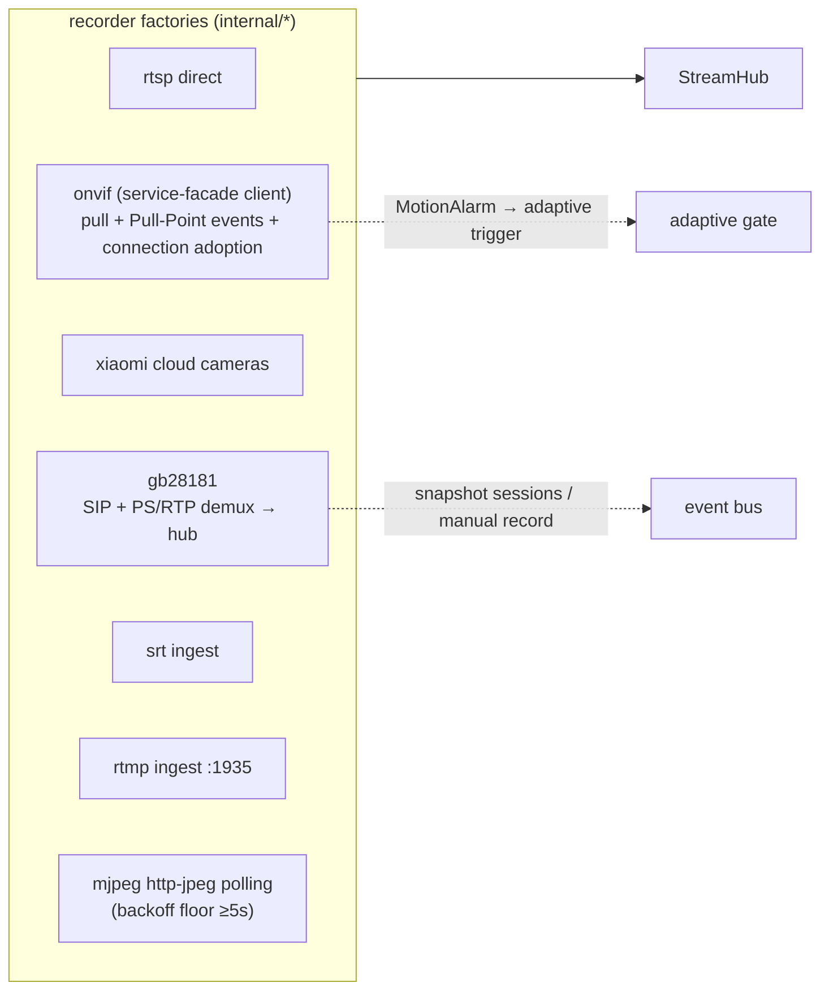
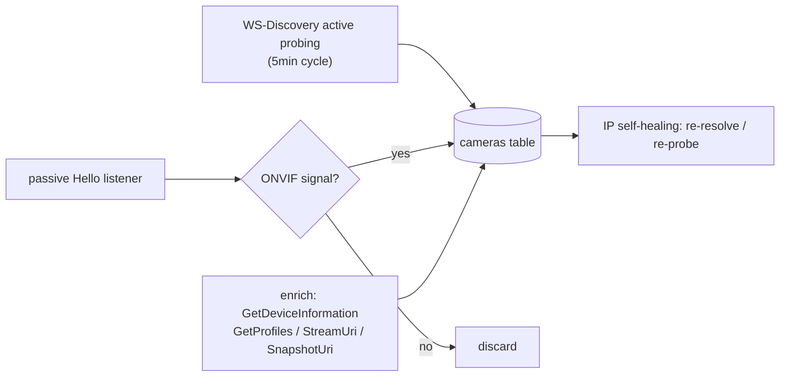
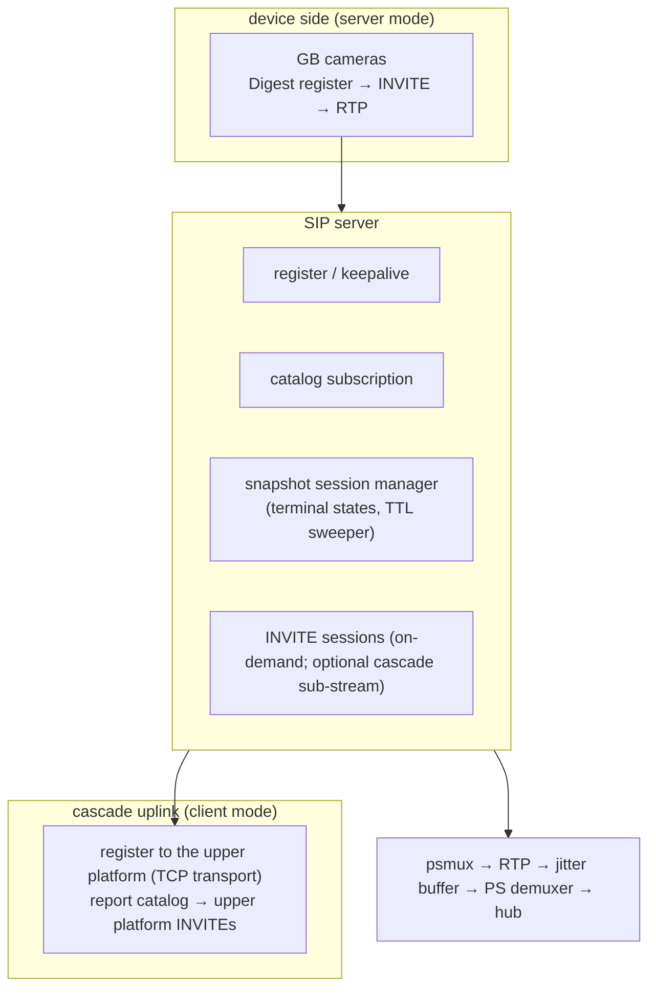

# Ingest Protocols, Discovery & GB28181

Eight ingest factories feed one frame bus. "Protocol differences stay inside the
factory; nothing downstream of the hub knows about protocols" is the layering
rule of this area.

## 1. Factory overview

Notes:

- ONVIF: `GetServices` resolves the media XAddr (ver10 → ver20, stale host
  rewrite); a successful probe connection can be **adopted** by the recorder
  (no duplicate dial). Passive WS-Discovery Hello listening filters non-ONVIF
  signals so Windows/WSD hosts never become zombie cameras.
- Camera grouping (schema v36–v38): a group registry with ordering, drag & drop
  moves, inline renames — a pure UI-organization field that recorders never read.
- Sub-stream capable cameras feed the on-demand layer (see
  [streaming.md](streaming.md)).

## 2. Auto-discovery & IP self-healing

## 3. GB28181: device mode and cascade mode

- The media plane uses TCP transport for cascade (UDP lost catalog updates in
  the field); archived cameras are filtered out of the cascade catalog
  (live DB rows only, fail-open).
- For media-plane corruption triage (four independent root-cause families:
  muxer races, marker truncation, UDP burst loss, half-drained buffers), see
  the troubleshooting methodology kept alongside the PR history of #440–#445.
