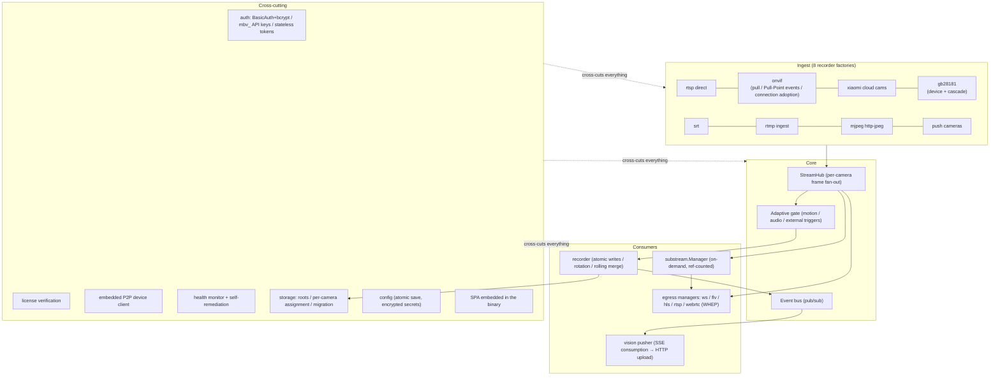
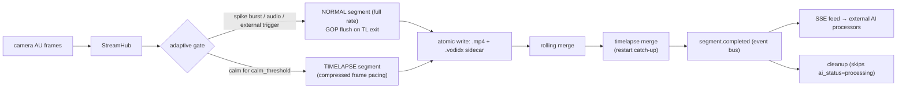
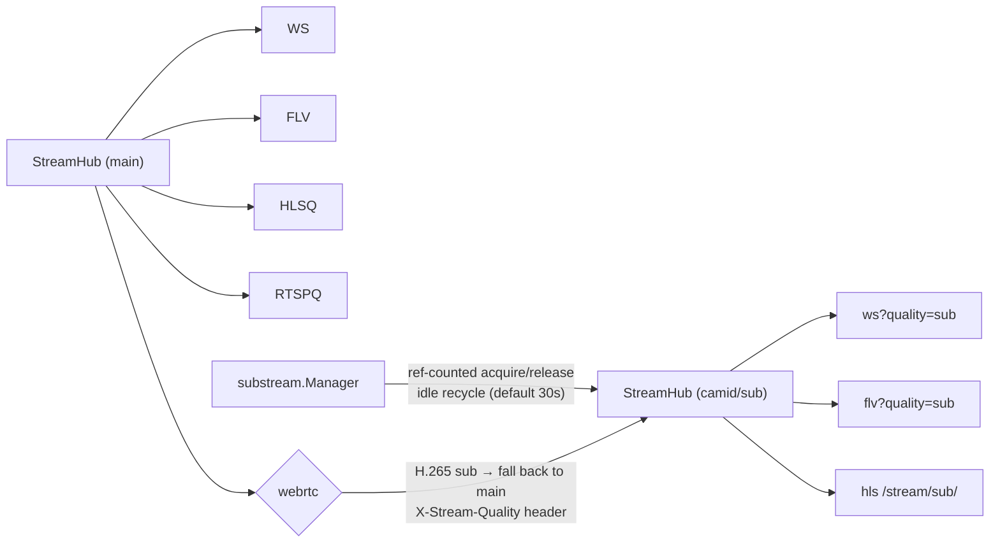
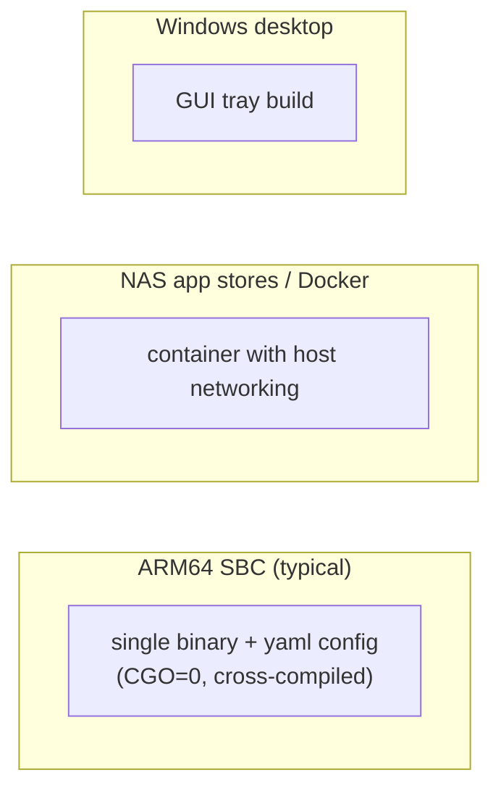

# Overview: Layered Architecture & Data Paths

MiBee NVR is a single static Go binary (CGO disabled) with an embedded Svelte 5 SPA.
Protocol differences end at the ingest factories; everything downstream of the
`StreamHub` frame bus is protocol-agnostic.

## 1. Layered view

## 2. The two main data paths

### Recording (with adaptive)

### Live streaming (multi-protocol egress + sub-streams)

See [streaming.md](streaming.md) for the full protocol matrix.

## 3. Service orchestration

`pkg/app` starts ~19 services in dependency order and stops them in reverse.
A startup failure aborts the process, except for services explicitly marked
"log-only" (e.g. the P2P client and the RTSP server when their port is taken).
State lives in SQLite (idempotent, versioned schema migrations); recordings,
events, AI status and audit rows share one database file.

## 4. Deployment forms

- Never compile on the target device — cross-compile from a dev machine.
- The SPA is rebuilt and embedded at build time; a binary refresh must always
  ship a freshly built SPA.
- Windows GUI builds need `-H windowsgui` to avoid a console window.
