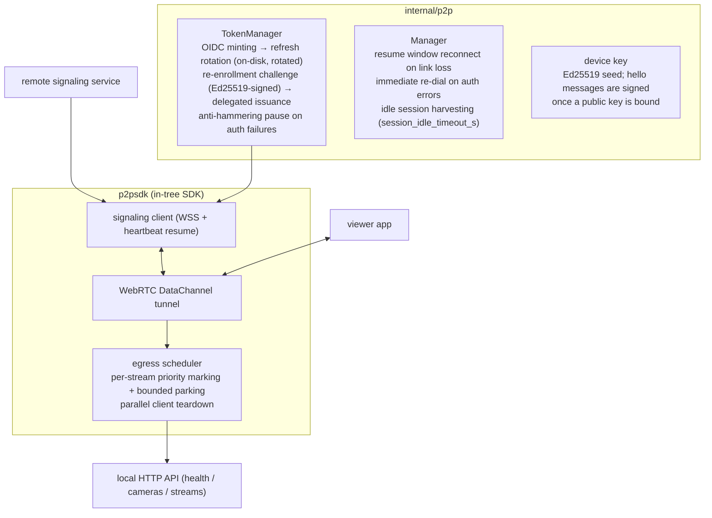

# Embedded P2P Remote Access (Device Side)

MiBee NVR can act as a **device** in a peer-to-peer remote access network,
serving its HTTP API and live streams through a WebRTC DataChannel tunnel when
the viewer cannot reach the LAN. This guide covers the NVR side only; the
server side is operated separately.

## 1. Components



## 2. Session lifecycle & resilience

```mermaid
sequenceDiagram
    participant NVR as NVR (p2p device)
    participant SIG as signaling service
    participant APP as viewer app
    NVR->>SIG: hello (account JWT or device signature)
    SIG-->>NVR: welcome (ice_servers / relay_url)
    Note over NVR: session_open pre-establishes the link for fast first view
    APP->>SIG: join (JWT / guest code redemption)
    APP<->>NVR: WebRTC DataChannel tunnel (end-to-end encrypted payloads)
    APP->>NVR: HTTP API + streams through the tunnel
    Note over NVR,APP: DataChannel failure/overload → relay fallback<br/>(session-level full rebuild, never partial reconnect)
    NVR-->>NVR: link loss: resume within the window, else full re-dial<br/>idle sessions harvested; any inbound frame resets liveness
```

## 3. Security model

- **Identity**: service-account JWTs or re-enrolled device accounts with a
  bound Ed25519 public key (key rotation re-binds the key; revocation is
  irreversible — use disposable device IDs for drills).
- **License**: local autonomous verification combined with server-side account
  checks (patching out the local check does not bypass the server ledger).
- **Payloads**: end-to-end encrypted at the session level — relays and the
  signaling service are zero-knowledge toward content.
- Credentials are stored encrypted in the YAML config; raw keys never leave
  the device.

## 4. Hardened failure modes (public regression history)

| Symptom | Root cause | Fix anchor |
|---|---|---|
| ICE restart loop every 30s | no failure cap in session recovery | state guards + bounded retries in the SDK |
| 7–12s stalls under load | head-of-line blocking on a single DataChannel | per-stream egress scheduler |
| Long outages from stale relay sessions | token reuse after expiry | per-call token minting; auth rejection drops the ladder |
| Slow reconnect after suspend | dead sessions kept in backoff | resume fast path + idle harvesting |
| Relay loops every 40–80s | liveness keyed to a single message type | any inbound frame resets liveness |
| Session leaks | missing close on failed offer paths | offerer close-path fixes in the SDK |
