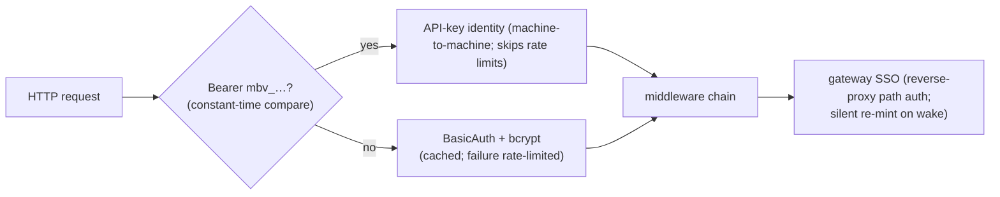
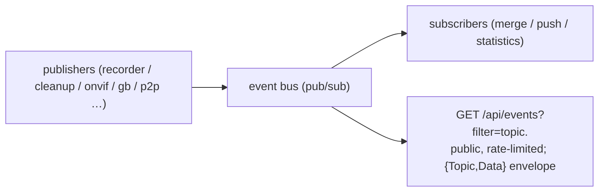
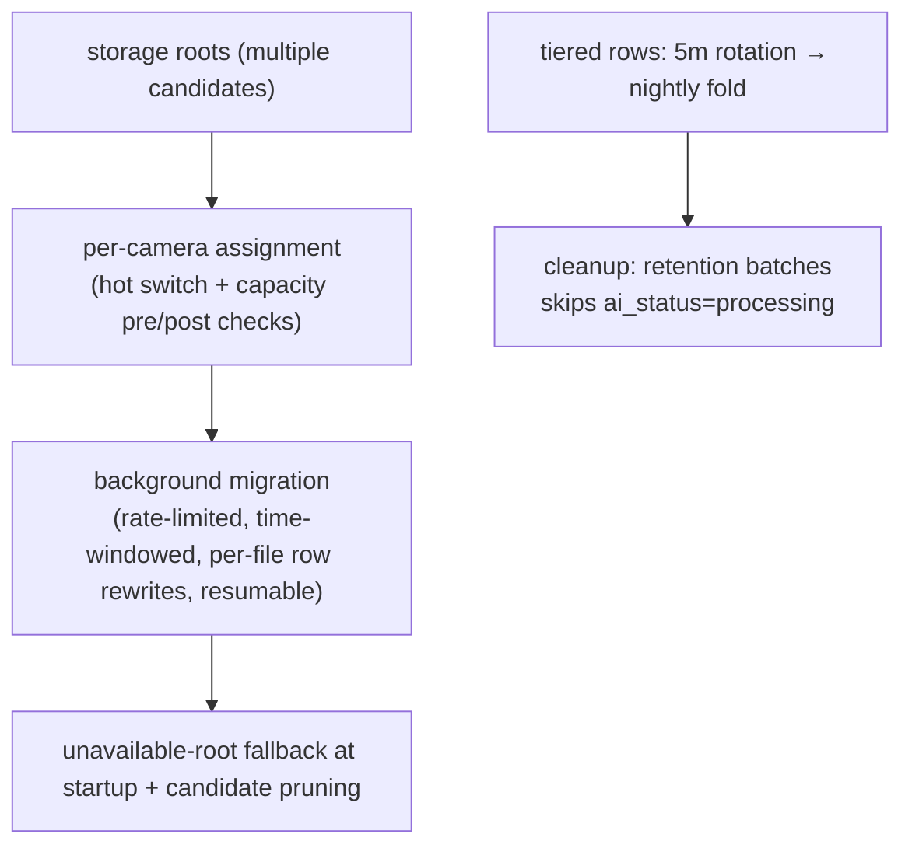

# Platform Cross-cutting Concerns

Auth, events, storage, config, health and SPA delivery — the foundation every
feature area stands on.

## 1. Auth chain

- `?api_key=` query fallback exists for SSE/WebSocket clients that cannot set
  headers — the URL itself carries the credential.
- API keys are independent of user passwords, revocable, and never expose user
  credentials.
- A stateless session token layer sits above BasicAuth; login failures are
  rate-limited (never auto-retry on auth failure).

## 2. Event bus & SSE

The bus is the loose-coupling spine: AI push, cascade catalogs, notifications
and webhook/MQTT triggers (HMAC-signed, replay-windowed) all hang off it.

## 3. Storage management

## 4. Configuration

- Many top-level sections plus an extension map for out-of-tree consumers;
  atomic saves (tmp + rename); credential fields stored encrypted.
- The running process re-serializes the whole YAML on shutdown — patch config
  files with the service stopped, never live.

## 5. Health & observability

- Periodic health checks with self-remediation (source restarts, session
  rebuilds); remote log shipping; Prometheus metrics for auth and HTTP.
- Update checks compare git-describe builds against the base tag so
  development builds never show a phantom "update available".

## 6. SPA delivery

- Svelte 5 + Vite; the build lands in `internal/ui/static` and is embedded in
  the binary — **a binary refresh must always ship a freshly built SPA**.
- The service worker caches by content fingerprint; cache-busting follows the
  build hash.
