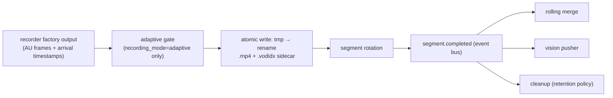
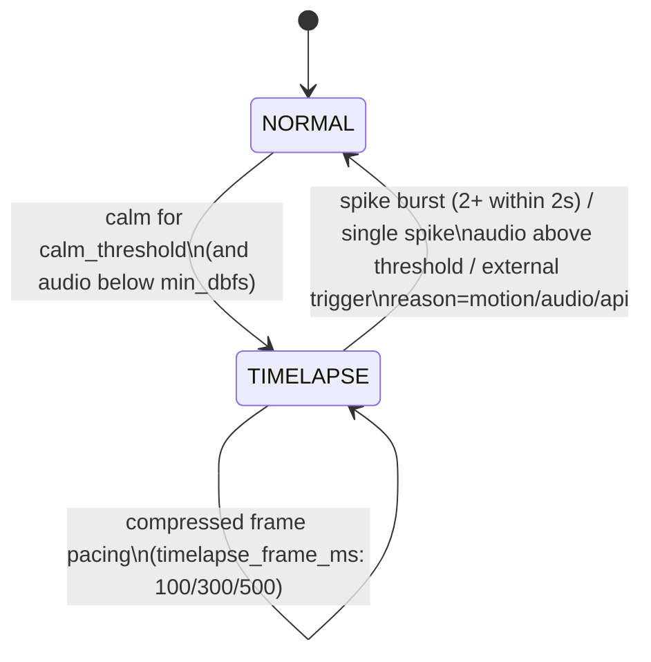
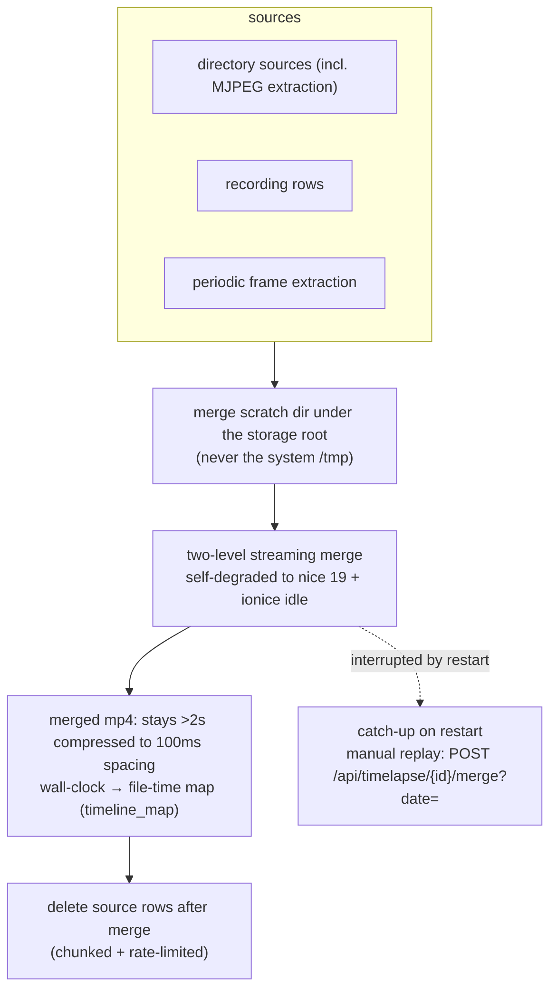

# Recording Pipeline & Adaptive Recording

Recording is the primary data plane: from frames to segments, to merged artifacts,
to events and cleanup.

## 1. Pipeline

Design points:

- **Arrival-timestamp anchoring** (#508): every access unit carries its arrival
  time; recording PTS, rotation and segment starts are all anchored to arrival
  time. This prevents DTS collapse and reference-chain damage after processing
  backlogs (burst-then-drain).
- **Atomic writes + sidecar**: crashes never leave half segments; `.vodidx`
  supports fast duration/offset queries.
- **Tiered rows**: 5-minute rotation plus a tier-merge CLI and a nightly fold
  job; tier-1 rows are born final and do not enter server-side merging.

## 2. Adaptive gate (NORMAL ↔ TIMELAPSE)

- Triggers are **OR-combined**: video motion (foreground area / spikes), audio
  RMS (G.711 table decode, 1s dBFS windows), or the external API
  `POST /api/cameras/{id}/adaptive/trigger` — leaving semantic classification
  to external AI processors.
- **TL exit = GOP flush** including pre-capture rings (video frame ring + audio
  ring, with written markers to avoid duplicates). Known early defects
  (single-spike math making TL unreachable, double-write on exit, cross-segment
  frame skips) are fixed with regression tests in the tree.
- **Audio triggering** works for G.711 streams; AAC/Opus have no pure-Go decoder
  and are skipped with a warning. Per-camera `audio_in_recordings` defaults to
  false (recordings are video-only by default).
- Optional ambient audio layer: sparse segments record continuous G.711 that is
  envelope-mixed during merge.

## 3. Timelapse merge

- The `timelapse-merge --execute` CLI is the offline batch entry point for
  production loads (`--no-throttle` escape hatch).
- The wall-clock → file-time map lets the SPA seek by wall-clock time (`?at=`)
  while rows keep wall-clock durations.
