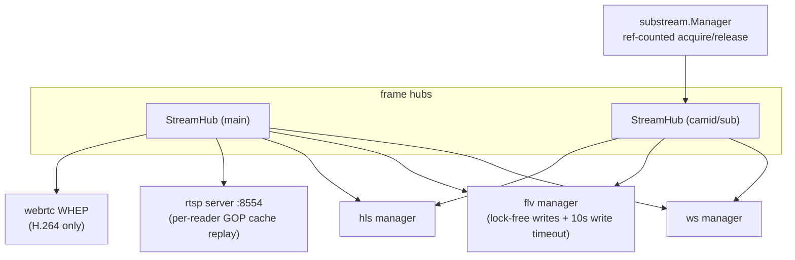

# Streaming Egress, Sub-streams & Quality Negotiation

One frame hub per camera, five egress protocols, plus on-demand sub-streams —
"zero cost when nobody is watching" is the core design goal of this area.

## 1. Overall view



## 2. On-demand sub-streams

```mermaid
sequenceDiagram
    participant C as consumer (quality=sub)
    participant API as endpoint (ws/flv/hls)
    participant SM as substream.Manager
    participant CAM as camera sub-stream
    C->>API: request (query quality= or path /stream/sub/)
    API->>SM: Acquire(camid) — ref count
    SM->>CAM: RTSP DESCRIBE (codec sniffing; SDP without sprop accepted)
    SM->>CAM: pull → publish to StreamHub(camid/sub)
    API-->>C: data (X-Stream-Quality: sub)
    Note over SM: zero refs + idle timeout (default 30s) → recycle<br/>sub-stream unavailable → fall back to main (X-Stream-Quality: main)
    C->>API: disconnect
    API->>SM: Release (same-hub identity guard avoids killing a fast re-acquire)
```

- Resolution: manual `sub_stream_url` (rtsp) or `sub_profile_token` → ONVIF
  `GetStreamUri` against the **media** service endpoint.
- **ONVIF profile metadata can lie** (advertising H.264 while streaming H.265) —
  the DESCRIBE result is authoritative.
- WebRTC sessions hold session-scoped references (`SetOnSessionEnd`); an H.265
  sub-stream over WHEP always falls back to main.

## 3. Protocol matrix

| Protocol | Entry | Key behavior | Notes |
|---|---|---|---|
| WS | `stream/ws?quality=` | frame push | viewer counts sum both hub keys (main+sub) |
| FLV | `stream.flv?quality=` | GOP cache fast-start | slow clients never block the hub (writes outside the lock with timeout) |
| HLS | path form `/stream/{sub,}/index.m3u8` | low-latency mode is tri-state; `stream.m3u8` alias rewriting | unknown names 404 instead of an empty 200 playlist |
| RTSP | `rtsp://host:8554/<camid>` | per-reader streams with re-sequenced RTP; hot SDP parameter-set reload | joining mid-GOP warns until the next IDR (open GOPs) |
| WHEP | WebRTC endpoint | H.264 only; H.265 sub → fallback | sessions bucketed per stream key |

## 4. Quality negotiation (SPA side)

- The surveillance grid defaults to "smooth" (sub-stream); the live view has a
  per-camera quality switcher; both persist to localStorage.
- `effectiveQuality()` is the black-screen guard: flv/hls request `sub` only
  when the sub-stream codec is known to be H.264 or the browser can decode
  H.265 via MSE; unknown → main first; switching re-mounts the player.
- `/protocols` reports `rtsp{available,url}` and
  `sub_stream{available,source,reason,codec}`; consumers must read these
  reactively — a non-reactive read pins the quality to main.
