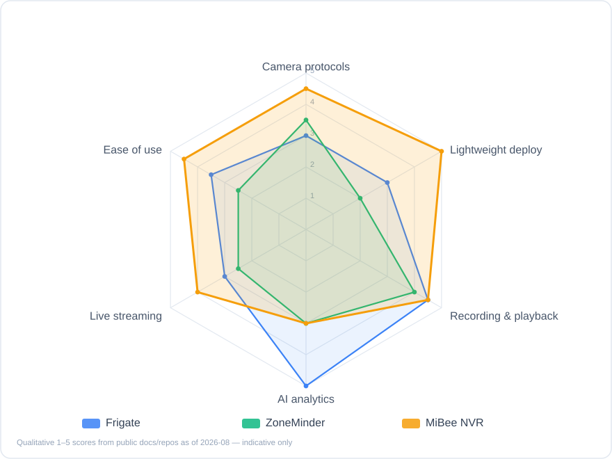
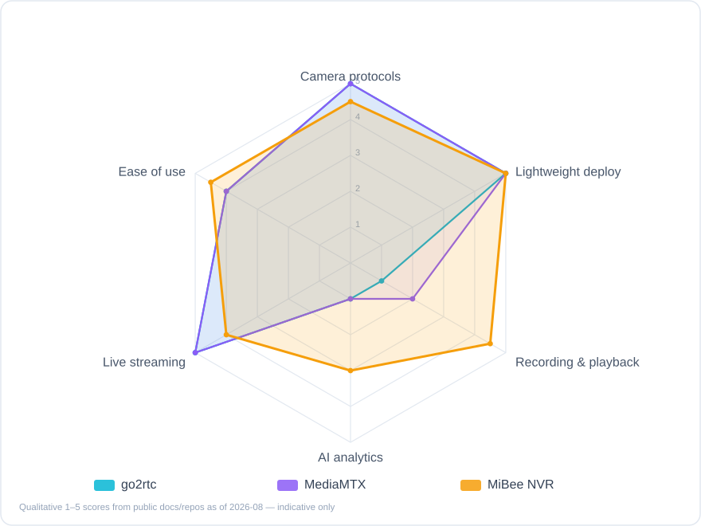

# How It Compares

> Scores are **qualitative assessments** based on public docs and repositories as of 2026-08 (AI and adaptive-recording entries updated 2026-10) — indicative only. Every project compared here is respected open-source work; the goal of this page is to help you find what fits *you*.

## The Short Version

- **Want the lightest possible "one old box + a few cameras" setup**, and value a native Chinese UI, Xiaomi cameras, GB/T 28181, audio and timelapse → **MiBee NVR** was designed for exactly this
- **Disk-constrained, and worried motion-only recording misses things** → MiBee's **adaptive recording** analyzes the compressed stream NVR-side: calm spans drop to a timelapse-grade baseline (75–98% less disk on static scenes, field-measured), and tiered mode keeps a 24/7 sub-stream baseline that misses nothing
- **Want realtime stream-inference AI event recording** (AI-triggered clips saved the moment detection fires, deep Home Assistant integration) → **Frigate** is the undisputed leader; MiBee's server-side AI is the official MiBeeVision companion engine — object detection over already-recorded segments, events written back and semantic triggers, i.e. segment-granularity post-analysis rather than realtime streams
- **Just want a media server** (protocol conversion, large-scale distribution, no NVR UI) → **MediaMTX** or **go2rtc** are purer tools for that
- **Need a Windows desktop app or commercial support** → **Blue Iris** (closed-source, paid) and friends fit better

## The Field

| Project | Category | Stack | Deployment | License | GitHub stars\* |
|---------|----------|-------|------------|---------|----------------|
| **MiBee NVR** | Lightweight self-hosted NVR | Go + embedded Svelte SPA | Single binary / Docker / 6 NAS app stores | AGPL-3.0 (≤v0.10.1 MIT forever) | 95 |
| [Frigate](https://github.com/blakeblackshear/frigate) | AI-first open-source NVR | Python + Docker | Docker (Coral/hw-accel recommended) | MIT | 35k |
| [ZoneMinder](https://github.com/ZoneMinder/zoneminder) | Veteran open-source NVR/CCTV | PHP + MySQL (LAMP) | Package managers / Docker | GPL-2.0 | 5.9k |
| [go2rtc](https://github.com/AlexxIT/go2rtc) | Streaming Swiss-army knife | Go | Single binary | MIT | 14k |
| [MediaMTX](https://github.com/bluenviron/mediamtx) | Media server | Go | Single binary | MIT | 19.9k |

\* Stars as of 2026-08. Other peers (Shinobi, iSpy/Agent DVR, …) are equally worth a look.

**Category note**: go2rtc and MediaMTX are strictly **media servers**, not NVRs — they answer "how do streams move", not "how is footage managed and replayed". They're included because they routinely appear in the same shortlist.

## Radar Charts

*Fig. 1: Qualitative comparison with full-featured open-source NVRs (1–5). Different strengths: Frigate goes deep on AI, ZoneMinder brings years of maturity, MiBee NVR bets on lightness and protocol breadth.*

*Fig. 2: Qualitative comparison with lightweight media servers. go2rtc / MediaMTX are the ceiling for protocol matrices and distribution — but have no recording management, playback UI or NVR semantics.*

## Capability Matrix

| Capability | MiBee NVR | Frigate | ZoneMinder | go2rtc | MediaMTX |
|------------|:---------:|:-------:|:----------:|:------:|:--------:|
| RTSP ingest | ✅ | ✅ | ✅ | ✅ | ✅ |
| ONVIF discovery / PTZ | ✅ | ⚠️ limited | ⚠️ limited | ❌ | ❌ |
| Xiaomi cameras w/o cloud | ✅ | ❌ | ❌ | ⚠️ partial | ❌ |
| GB/T 28181 | ✅ experimental | ❌ | ❌ | ❌ | ❌ |
| SRT / RTMP / WHIP push-in | ✅ | ⚠️ | ⚠️ | ✅ | ✅ |
| MP4 recording + retention | ✅ | ✅ | ✅ | ❌ | ⚠️ segments only |
| Adaptive write density (disk savings, nothing missed) | ✅ compressed-domain + tiered | ⚠️ via event retention | ⚠️ Mocord | ❌ | ❌ |
| Full-day continuous playback timeline | ✅ | ✅ | ⚠️ | ❌ | ❌ |
| Audio recording (AAC/G.711/Opus) | ✅ | ⚠️ | ⚠️ | ⚠️ passthrough | ⚠️ passthrough |
| Browser-side AI detection | ✅ | ❌ (AI is server-side) | ❌ | ❌ | ❌ |
| Server-side AI event detection | ⚠️ MiBeeVision · post-record | ✅ realtime · best-in-class | ⚠️ plugin | ❌ | ❌ |
| Timelapse | ✅ | ❌ | ❌ | ❌ | ❌ |
| Live relay out (RTMP/RTSP) | ✅ | ⚠️ via go2rtc | ❌ | ✅ | ✅ |
| WebRTC low-latency viewing | ✅ | ✅ | ❌ | ✅ | ✅ |
| H.265 live in browser over plain HTTP | ✅ WASM | ❌ | ❌ | ⚠️ partial | ❌ |
| NAS one-click app packages | ✅ 6 stores | ⚠️ community | ⚠️ | ❌ | ❌ |
| Chinese UI / Chinese docs | ✅ | ❌ | ❌ | ❌ | ❌ |
| Runtime dependencies | None (FFmpeg optional) | Docker + Coral advised | LAMP stack | None | None |

## Dimension Notes

### Protocols & Ingest

MiBee NVR differentiates on **breadth**: RTSP / ONVIF / Xiaomi / GB/T 28181 / SRT / RTMP / WHIP push-in / HTTP-JPEG — close to every camera shape a home or small project encounters. go2rtc and MediaMTX have equally vast protocol matrices (including transports we don't offer, like QUIC), but they don't manage recording lifecycles. Frigate and ZoneMinder center on RTSP with limited ONVIF support.

### Recording & Playback

MiBee NVR offers MP4 segments + rolling merge + per-camera retention + a full-day playback timeline + timelapse — complete NVR semantics. Frigate's event clips + continuous recording + second-level review UI is one of the best experiences in class. ZoneMinder's event system is mature but the UI shows its age.

### Adaptive Recording & Storage Efficiency

Nothing happens 95% of the time in most surveillance scenes, yet continuous recording writes every frame at full bitrate. The industry's three routes: **camera-side smart codecs** (Dahua Smart Codec, the Uniview / VIVOTEK adaptive-recording family) have the camera drop its own frame rate — saving bandwidth too, but locking detection quality to vendor firmware with nothing to tune NVR-side; **traditional NVR event schedules + dual streams** lack a native "sub-stream 24/7 + main stream on demand" combination; **motion-triggered / retention-by-event** (Frigate, ZoneMinder Mocord) records full-rate and keeps what matters via detection or retention policy, with detection that decodes frames.

MiBee NVR makes the call **NVR-side in the compressed domain**: P-frame sizes against a rolling baseline — zero decoding, works with any H.264/H.265 camera. Calm spans drop to timelapse-grade sparse writes; any of five signals (bitrate spike / audio loudness / pixel-domain CV on the sub-stream / camera-side ONVIF events / an external semantic API) resumes full rate, with a GOP ring pre-buffer flush so the switch loses zero frames. Tiered mode records the sub-stream 24/7 as a never-miss baseline — a combination still an open feature request in Frigate ([#2082](https://github.com/blakeblackshear/frigate/issues/2082), as of 2026-10) — and the `eval-replay` subcommand replays existing footage through the gate for offline parameter tuning. Honest edges: it saves disk, not camera bandwidth; semantic verdicts arrive from MiBeeVision or any external system (MQTT / trigger API) at segment granularity — not Frigate's realtime stream inference. Details in [Adaptive Recording](adaptive-recording.md).

### AI

MiBee NVR's AI comes in two layers. The **browser side** (ONNX Runtime Web) is built in with zero server load — aging hardware stays usable and multiple viewers share compute. The **server side** is the official companion engine **MiBeeVision**: distributed free in the NVR repository since 2026-10 (independent version line), it runs object detection and tracking over already-recorded video, generates events by zone / tripwire / loitering rules and writes them back to the NVR, and can raise the main stream via adaptive recording's semantic trigger. The honest boundaries remain: Vision analyzes segments already on disk (minutes-level latency), not realtime streams; the Lite build is single-camera, CPU inference (Linux x86_64/ARM64). For unattended 24/7 realtime stream inference across many cameras with deep Home Assistant integration, Frigate (with a Coral TPU) is still the right choice.

### Footprint & Deployment

MiBee NVR's design baseline is a 1GB-RAM low-end ARM board (512MB process ceiling) — one static binary, zero external dependencies, single-file SQLite. go2rtc / MediaMTX are Go single binaries too; all three are comparably light. Frigate needs Docker and prefers hardware acceleration for inference (Coral / iGPU / Jetson), with a higher baseline. ZoneMinder's PHP + MySQL stack is the heaviest on low-end devices.

### Ecosystem & Integration

Frigate's Home Assistant integration depth is its moat; ZoneMinder has two decades of tutorials. MiBee NVR ships MQTT / WebDAV / FTP / Prometheus / REST API + API keys — a "standard interfaces, light integration" route. The native Chinese UI and documentation are another clear differentiator.

## When You Should Pick Something Else

We're happy to see you pick the right tool, even when it isn't ours:

- **Realtime stream-inference server-side AI, many cameras, already on Home Assistant** → Frigate
- **A media server / large-scale distribution / WebRTC fan-out** → MediaMTX (strongest single-box distribution) or go2rtc (king of protocol conversion)
- **A Windows install-and-go app, happy to pay** → Blue Iris and other commercial options
- **Enterprise VMS (hundreds of channels, RBAC, alarm platforms)** → commercial VMS (Milestone, …) or commercial NVRs

And the profile where MiBee NVR fits:

- You have a NAS / Raspberry Pi / mini PC and want it **running today**
- You own **Xiaomi cameras** you'd like to free from the cloud, or **GB/T 28181 devices** to hook up
- You care about **audio, timelapse, a native Chinese UI**
- **Disk space is tight**, and you want "sparse when calm, full-rate when it matters" with zero frames lost at the switch
- You want **server-side AI detection** (the free official MiBeeVision Lite companion) and can live with segment-level latency and single-camera to start
- You'd rather not babysit databases, message queues or container orchestration — it's one binary

## Method & Updates

Radar and matrix scores are qualitative (1–5), compiled from each project's README / official docs / public repo information as of 2026-08 (AI and adaptive-recording entries updated 2026-10). Open-source moves fast — if you spot a stale score or a factual error, please [open an issue](https://github.com/Mi-Bee-Studio/MiBeeNvr/issues) and we'll update promptly.
