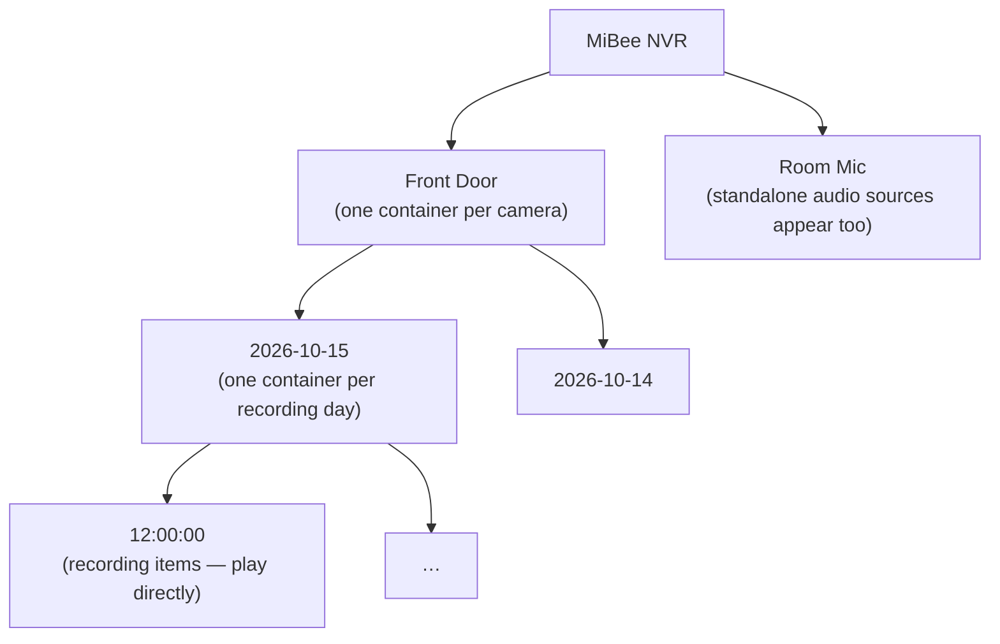

# DLNA Media Server

Turn the NVR into a UPnP AV / DLNA media server: TVs, Android TV boxes and
network players on the LAN discover it automatically via SSDP — no URLs to
type, no app to install. Browsing follows the recording structure:



Default **off** — DLNA has no authentication model, so the surface is bound
only to the configured (or auto-detected LAN) interfaces and is never
exposed across remote-access relays or P2P tunnels.

## Enable

```yaml
dlna:
  enabled: true
  port: 49152            # per-interface HTTP port
  # interfaces: [eth0]   # restrict; empty = every LAN IPv4 interface
  # friendly_name: ""    # name on renderers; default: server.device_name
```

Restart the NVR after changing the section. The same fields are editable at
**Settings → DLNA** (enable toggle, port, friendly name, interface list) —
saving answers `restart_required: true` for the same reason. The SSDP
announcements ride UDP 1900; the device description, Browse control and item
downloads ride the configured TCP port on each bound interface.

## What renderers see

- Items are the recorded files themselves — MP4 for H.264/H.265 (and
  timelapse products), AVI for MJPEG recordings, audio MP4 for standalone
  audio sources. Each item carries codec/size/duration metadata so the
  renderer decides playability itself; seek support uses HTTP ranges.
- Live streams are **not** exposed in this version — DLNA renderers handle
  live sources poorly, and the Web UI / [WHEP](streaming-protocol-selection.md) path is the
  right tool for live viewing.
- Browsing is read-only; recordings are never modified or deleted via DLNA.

## Troubleshooting

- **The NVR does not appear on the TV** — check the TV is on the same
  LAN segment (SSDP multicast does not cross routed/guest networks), the
  interface list includes the right NIC, and UDP 1900 / the configured TCP
  port are not blocked between the two devices.
- **A recording is listed but will not play** — the TV lacks a decoder for
  that item's codec (common with H.265 on older TVs); recordings stay
  available through the Web UI.
- **Two NVRs on one network** — each announces its own UUID derived from
  hostname + storage root, so they coexist; set distinct `friendly_name`s
  to tell them apart on screen.

## Next steps

- [Recordings & playback](recording-playback.md) — the same library in the Web UI
- [Audio](audio-sources.md) — standalone audio sources that appear as containers
