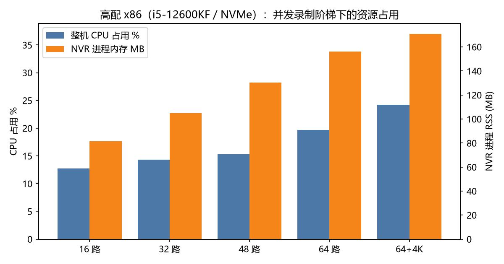
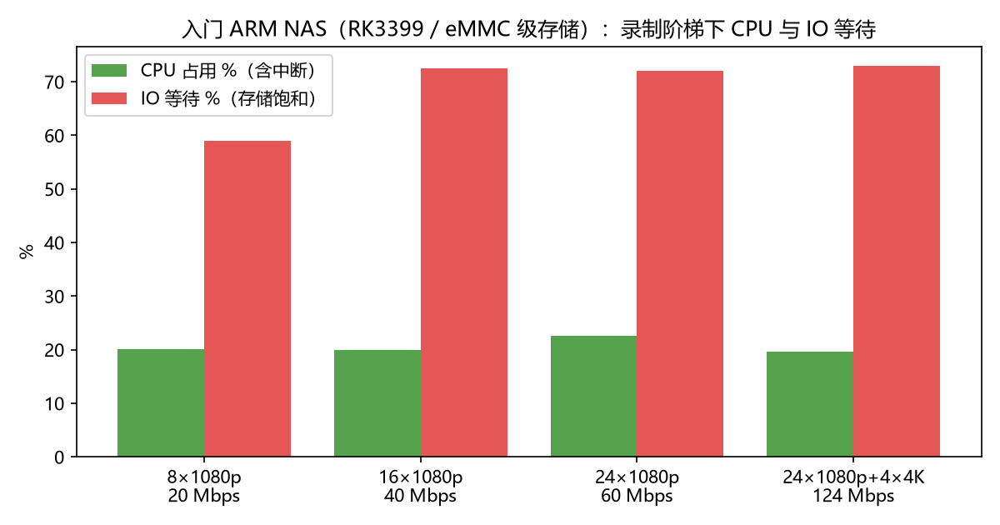
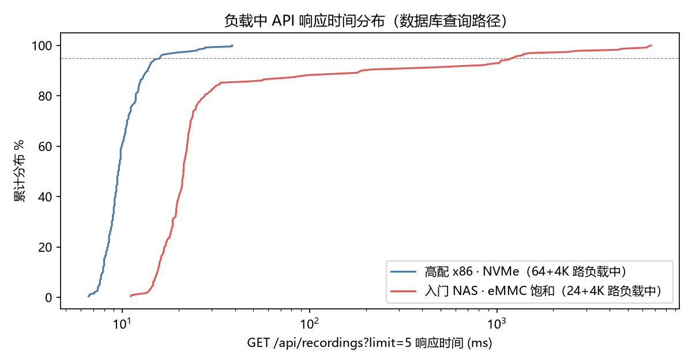

# Performance Benchmark Report (2026-09)

> Test dates: 2026-09-23/24 · Version under test: v0.13.0 preview (controlled tests on a unified build, commit `484204ff`; the production observation unit ran a preview build from the same period)
> Data nature: **vendor self-test**. The methodology and judging criteria are published in full; see §8 for how to reproduce on comparable hardware.

## 1. Background and Purpose

The NVR industry currently lacks public performance data with clearly stated measurement conditions: no third-party cross-product benchmark exists. What you can find is either vendors' own partial metrics (e.g. detector inference time) or editorial estimate tables that do not state hardware, bitrate, or frame-rate conditions — none of it comparable.

This report contributes a self-tested dataset for MiBeeNvr. The goal is not to claim superiority over other products (no comparable public baseline exists), but to measure and publish MiBeeNvr's own capacity and resource curves across hardware tiers, for sizing and reproduction reference. To allow comparison with community capacity-planning conventions, loads are also expressed in MP/s (see §3.3).

## 2. Test Environment

| Device | Role | CPU | RAM | Storage | Deployment |
|---|---|---|---|---|---|
| Banana Pi M5 | Production unit (read-only observation) | Amlogic S905X3, ARMv8 ×4 | 4GB | 2.7TB SATA | bare metal, systemd |
| RK3399 NAS | Controlled load (low tier) | RK3399 ×6 | 4GB | eMMC-class volume | fnOS + Docker |
| x86 workstation | Controlled load (high tier) | i5-12600KF, 10C16T | 64GB | NVMe | bare metal |
| x86 laptop | Traffic generator / idle measurements | 8 cores | 16GB | SSD | — |

The RK3399 NAS storage volume is a single-member RAID1 on an eMMC partition plus a thin-provisioned volume — 2× write amplification. This detail recurs throughout the data below and is the key to reading that tier's results. The production unit happened to be running a historical-recording archival migration during the test window, which yielded both a "high IO pressure" and a "normal" observation window on the same device.

## 3. Methodology

### 3.1 Load and measurement

- Synthetic cameras: pre-rendered MP4s pushed over RTMP with `-re` real-time pacing, two profiles — 1080p25 H.264 2.5 Mbps (2s GOP, no B-frames) and 4K25 H.264 16 Mbps. Pushers include disconnect/reconnect behavior to match real cameras. Per-camera accounting: `/api/streams` counters snapshotted every 30s, cross-checked against per-stream ingress bitrate.
- Resource sampling: on Linux, `/proc/stat` raw counters every 5s (CPU and IO-wait separable), `/proc/meminfo`, and NVR process RSS; on Windows, performance counters at the same cadence. Disk ground truth from iostat.
- API probe: `/api/health` (public path) and `/api/recordings?limit=5` (authenticated + SQLite query path) every 5s, recording the full latency distribution and failure count.
- Viewers: real pull clients over FLV / LL-HLS / RTSP watching concurrently, tracking throughput, time-to-first-byte, and live-edge latency (LL-HLS computed from the playlist's PROGRAM-DATE-TIME).

### 3.2 Judging criteria

CPU usage includes soft interrupts; IO wait is listed separately. "Steady-state window" = the 4 minutes starting 60–75s after the last pusher starts; API latencies in tables are steady-window percentiles. All curves have 5-second raw data behind them.

**Configuration baseline**: except for the controlled experiment in §6.4, every test ran on factory-default configuration — `storage.durability` at the default `strict` (fsync on every segment finalize, strongest durability), `io.budget_bytes_per_sec` at the default 0 (background IO budget off), and pre-allocation on. In other words, the headline numbers are measured in the default posture, without any optimization switch that must be turned on manually.

### 3.3 Load conversion (MP/s)

Converted to the MP/s unit common in community capacity planning: 1080p25 = 51.8 MP/s per camera, 4K25 = 207.4 MP/s. The x86 peak of 68 cameras ≈ **4,145 MP/s**; RK3399 pure forwarding of 30 cameras ≈ **1,555 MP/s**. Note: MiBeeNvr records in the compressed domain without decoding, so MP/s here expresses throughput magnitude for comparison with common methods — it is not equivalent to decode-based load.

## 4. Idle Footprint and Startup

Zero-camera idle instance on the laptop, 36 minutes of observation (432 samples):

| Metric | Measured |
|---|---|
| Distribution | single static binary, 67 MB (CGO=0, embedded web UI, no runtime dependencies) |
| Cold start → API ready | 10 runs, 115–184 ms, median 122 ms |
| Idle memory (RSS) | 37.3–38.8 MB |
| Idle CPU | 0.0% |

RK3399 NAS container (24 GB28181 cameras registered, recording library over ten thousand rows): `docker start` → API ready in **1.46–1.59 s**; graceful container exit takes 1.5–6.3 s (data flushing).

## 5. High-Tier x86: Recording Ramp and Concurrent Viewing

Ramped from 16 to 68 cameras (64×1080p + 4×4K), 3 minutes of steady state per step, per-camera bitrates of 2.5/16 Mbps held exactly throughout:

| Load | Total ingress | Whole-machine CPU (16T) | NVR process memory | health p50/p95 | recordings p50/p95 |
|---|---|---|---|---|---|
| Baseline (1 real camera) | 2.0 Mbps | 11.4% | 57 MB | — | — |
| 16×1080p | 42.2 Mbps | 12.8% | 82 MB | 8.5 / 15.2 ms | 9.4 / 38.5 ms |
| 32×1080p | 82.3 Mbps | 14.3% | 105 MB | 8.9 / 14.5 ms | 9.0 / 14.0 ms |
| 48×1080p | 122.4 Mbps | 15.3% | 131 MB | 9.6 / 16.7 ms | 9.6 / 12.5 ms |
| 64×1080p | 162.4 Mbps | 19.7% | 156 MB | 10.6 / 18.2 ms | 10.1 / 22.7 ms |
| 68 cameras (incl. 4×4K) | 226.5 Mbps | 24.2% | 171 MB | 8.7 / 15.0 ms | 11.1 / 27.6 ms |

Observations: ~+3 MB memory per additional 1080p camera; CPU slope ≈ +2 percentage points per 40 Mbps (16-thread basis). The API probe recorded 0 failures throughout (also 0 during the 32-viewer stage); health returned to 1.2–1.9 ms after the test. This tier stopped at 68 cameras because the traffic generator reached its limit, not because the NVR misbehaved.

**On top of full load (68 cameras recording), 32 concurrent viewers** (12 FLV + 12 LL-HLS + 8 RTSP, 5 minutes):

| Protocol | Result |
|---|---|
| FLV | 12/12 sessions 200, each at a precise 2.50–2.51 Mbps; TTFB min/p50/p95 = 65/167/256 ms |
| LL-HLS | 12/12 served; playback start min/p50/p95 = 438/1414/2095 ms; live-edge latency median 1.3 s |
| RTSP | 8 clients, three rounds of pulling, 0 errors |

## 6. RK3399 NAS: Three Operating Profiles

### 6.1 Recording ramp (8 → 28 cameras, 20 → 124 Mbps)

| Load | CPU | IO wait | NVR memory | health p50 | recordings p50 |
|---|---|---|---|---|---|
| 8×1080p (20 Mbps) | 20.1% | 59% | 130 MB | 24 ms (entering saturation late) | 20 ms |
| 16×1080p (40 Mbps) | 20.0% | 73% | 162 MB | 2.0 s | 22 ms |
| 24×1080p (60 Mbps) | 22.6% | 72% | 203 MB | 2.0 s | 22 ms |
| 24×1080p+4×4K (124 Mbps) | 19.7% | 73% | 197 MB | 2.0 s | 22 ms |

The CPU curve flattens at 20–23%; the NVR process peaked at 41.8% of a single core. The saturation point is storage: iostat shows the volume device at 100% utilization, write waits of 3.4–6.9 s, and ~6–7 MB/s of actual writes (including RAID1 write amplification). Behavior after saturation is layered:

- Recording and per-camera accounting are unaffected (bitrates hold, segments land normally);
- Recording queries (SQLite read path) are unaffected, p50 steady at 20–22 ms;
- health degrades to 2 s — it performs a statfs against the storage volume that blocks when the device is saturated, which reads as a "storage is gasping" indicator light;
- Viewing under extreme saturation (second validation round): LL-HLS 8/8 clients received data but playback start took up to 88 s and live edge lagged 35–53 s; RTSP streamed normally; new FLV sessions could not establish within 15 s (healthy-state measured 106–135 ms).

Recovery curve after load removal (health p50 / same-period max): back to 17–23 ms within 0–1 minute, though background IO kept occasional requests at 2 s for ~6 minutes, after which max < 31 ms — no crashes, no process restarts throughout.

### 6.2 Clean low-load profile (4 cameras recording, 10 Mbps)

| CPU | IO wait | NVR memory | health p50/p95 | recordings p50/p95 |
|---|---|---|---|---|
| 16.7% | 44% | 77 MB | 24 ms / 1485 ms | 21 ms / 188 ms |

Occasional statfs spikes appear at just 10 Mbps of recording — further evidence that this tier's bottleneck is entirely the eMMC volume, not CPU or software.

### 6.3 Pure-forwarding profile (30 live cameras, no disk writes, 75 Mbps)

With 30 cameras set to live-only (`recording_enabled: false`):

| CPU | IO wait | NVR memory | health p50/p95/max | recordings p50/p95 |
|---|---|---|---|---|
| 30.5% | 15% | 95 MB | 21 ms / 40 ms / 62 ms | 21 ms / 30 ms |

With the write path out of the picture, the API distribution under 30-camera ingress + fan-out is completely clean; FLV pull against live cameras: 200, 2.52 Mbps, TTFB 135 ms. This profile shows the RK3399 has ample headroom as a pure live gateway (preview / cascade / relay scenarios) — ~1,555 MP/s of throughput on 30% CPU.

### 6.4 Controlled comparison: `storage.durability` strict vs relaxed

`durability` governs the fsync policy for raw recording segments (#760): the default `strict` fsyncs on every segment finalize; `relaxed` skips explicit fsync and leaves commits to the filesystem's writeback interval (a power loss may drop the last few seconds of raw segments; merged/timelapse products are unaffected — positioned as most beneficial for flash boards). To quantify the switch's real benefit on slow storage, a paired test — same load, same background (rolling-merge background tasks running in both) — was run on the RK3399 NAS:

| Profile | durability | health p50 / p95 | IO wait | CPU | NVR memory |
|---|---|---|---|---|---|
| 16×1080p (40 Mbps) | strict | 2024 / 3045 ms | 72.5% | 20.0% | 162 MB |
| 16×1080p (40 Mbps) | relaxed | 2019 / 2027 ms | 73.2% | 21.1% | 171 MB |
| 24×1080p (60 Mbps) | strict (first run) | 2022 / 2033 ms | 72.0% | 22.6% | 203 MB |
| 24×1080p (60 Mbps) | strict (paired re-run) | 2020 / 2035 ms | 68.4% | 24.9% | 217 MB |
| 24×1080p (60 Mbps) | relaxed | 2023 / 2040 ms | 54.7% | 31.7% | 131 MB |

Write-path instantaneous metrics do improve: under strict steady state the volume device showed write waits of 3.4–3.9 s and sustained 100% utilization; after switching to relaxed, write waits dropped to 0.2–0.3 s and utilization shifted from "sustained saturation" to "bursty". But across whole windows, the device's health latency and saturation threshold did not move — this NAS's storage pressure stacks multiple sources (2× write amplification from single-member RAID1, background batch IO from rolling merges, the system's own background reads). Removing recording fsync only converts sustained pressure into bursty pressure, not enough to pull the device back out of saturation.

Conclusion: on eMMC-class slow storage, `relaxed` smooths write queuing (a reasonable option for deployments that tolerate power-loss windows) but cannot change that storage's capacity ceiling; on fast storage such as NVMe (§5), the default tier is not a bottleneck in the first place, so there is nothing to gain. This section also demonstrates: the headline numbers in this report were measured under the default strict tier — not flattered by this switch.

Note: during the controlled comparison, one `docker restart` of that container hit a runtime hang (docker ps reported Up while the process no longer existed; stop/start recovered it; the exiting process logged no panic and the kernel recorded no OOM — a host-environment event, not an NVR crash). The event lost SQLite stream keys that had not been checkpointed (camera and recording data intact); the setup was rebuilt and testing continued — production deployments should restart through the normal path (systemd / app store) rather than `docker restart`.

## 7. ARM SBC Production Unit: Two Observation Windows

Banana Pi M5 (S905X3 ×4 / 4GB / 2.7TB SATA), 18 real cameras (mixed ONVIF / GB28181 / Xiaomi / MJPEG), running 24/7, with 2.1TB of recordings accumulated on disk (largest single camera: 467 GB / 2014 segments). Read-only observation, no changes made:

| Metric | Normal window (14 min) | High IO pressure window (46 min)¹ |
|---|---|---|
| health p50 / p95 / max | 12.2 / 25.3 / 1015 ms | 13.5 / 53 / 2232 ms |
| recordings p50 / p95 | 252 / 306 ms | 253 / 338 ms |
| Ingress bitrate / active cameras | 16.1 Mbps / 12 | 17.9 Mbps / 12 |
| NVR process RSS (min/avg/max) | 182 / 267 / 414 MB | 114 / 194 / 412 MB |
| SoC temperature (avg / max) | 51.2 / 54.5 °C | 52.6 / 58.3 °C |
| Whole-machine CPU (incl. IO wait) | 20.1% | 34.5% (iowait dominant) |

¹ The unit was executing a historical-recording archival migration during this window, disk IO wait around 80%; the NVR process itself used about half a core, recording continued.

On the same SATA device, health p50 held at 13.5 ms under 80% iowait — compare §6's 2 s under similar pressure on the eMMC volume: two orders of magnitude apart. The storage medium sets the experience ceiling of the low tier; this conclusion reproduced in production. The 250 ms-class recordings query matches its 2.1TB / tens-of-thousands-of-rows library size.

## 8. Uncovered Items and Reproduction Notes

Not covered: software transcoding scale (H.265→H.264 software transcode is CPU-intensive; production deployments should avoid it via direct sub-stream recording), WebRTC end-to-end latency (depends on browser-side measurement), 10GbE networking, cloud-archive throughput, audio tracks, and `io.budget_bytes_per_sec` background IO budget (off by default; background merge load existed throughout the test window but was not A/B tested separately, see §6.4). Synthetic streams were video-only.

Reproduction: the load specifications in §3 (synthetic stream parameters, pacing, reconnect behavior), sampling cadence, and judging criteria are published in full — comparable hardware with the same setup reproduces comparable curves. Same-hardware cross-product comparison (other NVRs, same machine, same load) likewise has no third-party public data in the industry today; it remains a follow-up item.

---

*MiBee team, 2026-09-24. All numbers are self-measured; measurement conditions in §3.*
